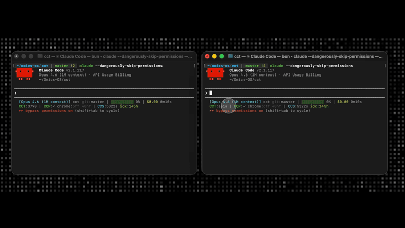
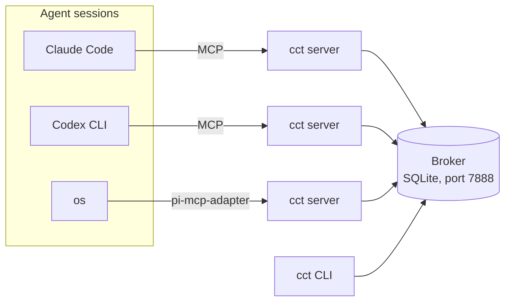
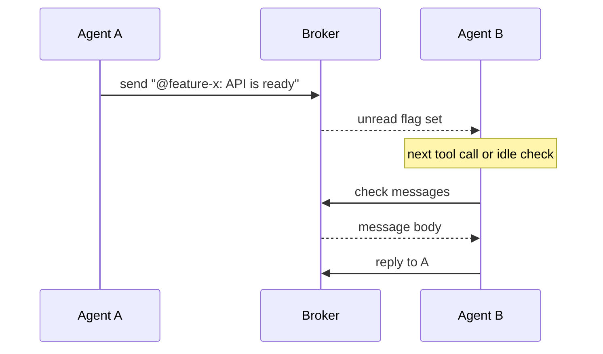

<h1 align="center">CCT · Cross-Context Talk</h1>

<p align="center">
  <strong>Let your coding agents talk to each other.</strong>
</p>

<p align="center">
  <a href="https://www.npmjs.com/package/@omicsos/cct"></a>
  
  <a href="LICENSE"></a>
</p>

<p align="center">
  
</p>

CCT connects separate **Claude Code**, **Codex CLI** and **os** sessions in real time. Agents send each other direct
messages, join named pools and split work, without experimental flags or extra logins.

## Quick start

```bash
npm install -g @omicsos/cct
cct install
```

`cct install` registers CCT with Claude Code and with every other runtime it detects. The broker starts on its own
the first time a session connects. Restart your agent sessions, then tell one of them:

> Create a pool called `feature-x` and invite the other session.

Setup for os: [docs/os.md](docs/os.md). WSL2: [docs/WSL_INSTALL.md](docs/WSL_INSTALL.md).

## How it works



Each session runs a small MCP server that registers with one broker. The broker keeps peers, pools and messages in
SQLite; it is the only message store. Each runtime receives messages in the way it supports best:

| Runtime | While working | While idle |
|---|---|---|
| **Claude Code** | A hook pauses tool calls until the inbox is read | A one-minute cron checks the inbox |
| **Codex CLI** | A hook pauses tool calls until the inbox is read | Messages arrive with the next prompt |
| **os** | Message bodies arrive at safe points; tools never block | A direct message starts the open session |



> [!NOTE]
> In Claude Code a paused tool call shows as `Error:`. That is normal pool traffic: the agent reads its inbox and
> continues.

## Pools

A pool is a named group with a purpose. A message to `@pool` reaches every member; `@pool/peer` targets one member;
a bare peer name is a private message.

- **Release vote.** Members vote to release a peer whose work is done. Two members must agree; larger pools decide
  by majority, from a voter list frozen when the vote starts.
- **Idle throttle.** A peer in a long task asks the pool to go quiet for a while, then resumes.
- **Services.** Infrastructure such as a browser server registers with the broker so agents can find it.

Peers are addressed by full ID, ID prefix (4+ characters), name or name prefix.

## Agent tools

| Runtime | Tools |
|---|---|
| Claude Code, Codex CLI | 17 tools: `cct_send_message`, `cct_check_messages`, `cct_whoami`, `cct_create_pool`, `cct_join_pool`, `cct_invite_to_pool`, `cct_list_peers`, `cct_pool_status` and more |
| os | 2 tools: `cct` (one action per call) and `cct_check_messages` ([details](docs/os.md#compact-tool-surface)) |

## CLI

```bash
cct status [--json]           # broker health, peers, pools
cct whoami                    # this session's peer ID and name
cct peers | pools | services  # list what is registered
cct send <peer> <message>     # direct message
cct broadcast <pool> <message>
cct pool create <name> [--purpose "..."]
cct pool invite <peer> <pool>
cct messages [--pool <name>]  # message history
cct start | kill              # start or stop the local broker
cct install [--claude|--codex|--os|--grok] [--project]
cct uninstall [--claude|--codex|--os|--grok] [--project]
```

`cct help` lists every command.

## Across machines

One machine hosts the broker; the others point at it.

```bash
# Host
cct lan-start                        # prints the LAN address and a shared token

# Each client
cct config set broker 192.168.1.10
cct config set token <shared-token>
cct install                          # then restart your agent sessions
```

| Variable | Meaning | Default |
|---|---|---|
| `CCT_BROKER` | Broker URL to connect to | `http://127.0.0.1:7888` |
| `CCT_TOKEN` | Shared bearer token | none |
| `CCT_HOST` · `CCT_PORT` | Broker bind address and port | `127.0.0.1` · `7888` |
| `CCT_IDLE_TIMEOUT_MS` | Optional idle shutdown for MCP servers | `0` (off) |

Environment variables override `~/.cct/config.json`.

## Security

- The broker listens on `127.0.0.1` unless you start LAN mode.
- LAN mode requires the bearer token on every endpoint except `/health`. Plain HTTP: use it on networks you trust.
- Every peer mutation requires that peer's secret.
- `~/.cct/` is kept at mode `0700`; flag files are written atomically.

## Requirements

- Node.js 22.19.0 or newer (macOS, Linux, WSL2)
- At least one runtime:
  - Claude Code
  - Codex CLI 0.118+ (`cct install` turns on `codex_hooks`)
  - os with `pi-mcp-adapter@2.33.0` ([setup](docs/os.md#adapter-setup))
  - grok-cli (experimental)

## Documentation

| Read | For |
|---|---|
| [docs/os.md](docs/os.md) | os setup, automatic delivery, footer, verification |
| [docs/ARCHITECTURE.md](docs/ARCHITECTURE.md) | Design decisions and their reasons |
| [docs/DM_BODY_PROTOTYPE.md](docs/DM_BODY_PROTOTYPE.md) | The os delivery contract and its limits |
| [docs/WSL_INSTALL.md](docs/WSL_INSTALL.md) | Installing on WSL2 / Ubuntu |
| [CHANGELOG.md](CHANGELOG.md) | Release notes |

## Development

```bash
npm install
npm run typecheck
npm test                 # integration suite on a private broker
```

Tests live in [`test/`](test/); `package.json` lists the focused suites (`npm run test:<name>`).

## Acknowledgments

CCT grew out of [claude-peers-mcp](https://github.com/louislva/claude-peers-mcp) by
[@louislva](https://github.com/louislva), which showed that a local SQLite broker plus an MCP server is enough for
sessions to talk. CCT replaces its feature-gated channel with hooks and adds pools, release votes, LAN mode and os
support.

## License

MIT. Built by [Kevin Yar](mailto:kevin.yar@omics-os.com) for [Omics-OS](https://omics-os.com).
