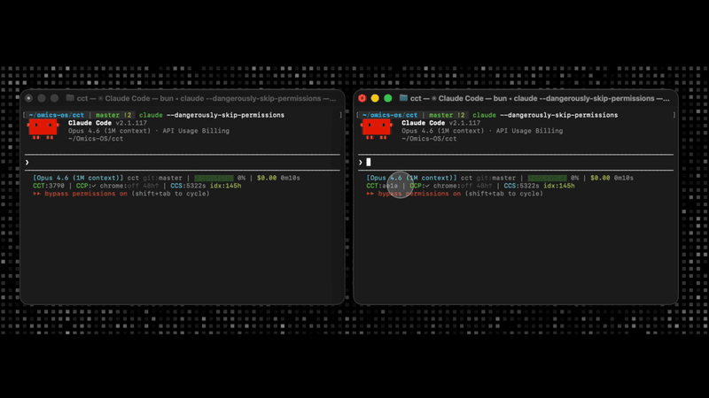

# CCT — Claude Code Talk

Real-time inter-session communication for AI coding agents. Supports **Claude Code**, **OpenAI Codex CLI**, and **os**. Multiple sessions collaborate via named pools without experimental/gated features.

<p align="center">
  
</p>

## Background

Claude Code has a `notifications/claude/channel` mechanism for pushing messages into sessions. [claude-peers-mcp](https://github.com/louislva/claude-peers-mcp) by [@louislva](https://github.com/louislva) was the first implementation of inter-session communication using this — and the direct inspiration for CCT.

The problem: channel registration is gated behind a server-side feature flag (`tengu_harbor`) that currently returns `false` for most users ([#36503](https://github.com/anthropics/claude-code/issues/36503)). Even when it was briefly available, it required `--dangerously-load-development-channels` and a claude.ai OAuth login — API key users are locked out entirely.

CCT takes a different approach. Instead of channels, it uses:

- **MCP tools** for all message operations (send, check, pool management)
- A **PreToolUse hook** (pure bash, <10ms) that blocks tool calls when unread messages exist, forcing Claude to read its inbox
- **CronCreate** for idle-session polling (60s)
- An os surface with compact direct MCP tools and automatic DM body delivery at safe boundaries

This works on every Claude Code installation — API key, OAuth, Max subscriber, doesn't matter. No experimental flags, no `--dangerously-*` flags.

## What CCT adds on top

Beyond the channel workaround, CCT introduces structured coordination primitives that `claude-peers` doesn't have:

- **Pools** — named groups with purposes, roles, and lifecycle (create → collaborate → release → archive)
- **Democratic release** — agents vote on when to release a peer from a pool (unanimous for 2, majority for 3+)
- **Busy signaling** — peers signal long-running tasks, others reduce polling automatically
- **LAN mode** — bearer-token-authenticated broker on `0.0.0.0` for cross-machine collaboration
- **Status line** — live peer ID, pool memberships, and unread counts in the Claude Code UI
- **Service registry** — infrastructure services (browser servers, etc.) register with the broker for discovery

## os automatic DM body delivery

Canonical `os-extension.ts` delivers actual DM bodies without a model-issued
inbox check. Bounded late acknowledgments follow a completed response to the
presented body context; they do **not** prove task completion. Incoming and
outgoing cards use readable foreground text and explicit matching backgrounds.
The outgoing formatter ships as CCT's `os-mcp-extension.ts` wrapper, delegating
to the unmodified `pi-mcp-adapter@2.33.0` factory. No os-core or third-party file
edits are required. See the [delivery contract](https://github.com/the-omics-os/cct/blob/v0.2.1/cct/DM_BODY_PROTOTYPE.md).

**Release status:** 0.2.1 is published on npm and GitHub; registry installation
and local setup are verified. User UI approval is complete. The existing
`v0.2.0` tag is preserved. See [release notes](https://github.com/the-omics-os/cct/releases/tag/v0.2.1).

## Quick Start

```bash
npm install
npx tsx cli.ts install   # auto-detects Claude Code + Codex CLI
# For os, first enable pi-mcp-adapter@2.33.0 as exactly one explicit
# global file/directory extension outside the autoextensions directory.
# See "os adapter setup" below; keep host and installer environments aligned:
export PI_CODING_AGENT_DIR="${OS_CODING_AGENT_DIR:-$HOME/.os/agent}"
export PI_MCP_CONFIG_MODE=exclusive
npx tsx cli.ts install --os
npx tsx cli.ts start     # starts the broker

# Open two sessions (any mix of Claude Code / Codex) — they auto-register
# In session A:
#   "Create a pool called feature-x and invite the other session"
# Messages flow automatically
```

## How It Works

```
Claude Code A ──► MCP Server ──► Broker (SQLite) ◄── MCP Server ◄── Codex CLI B
os A ────────────► pi-mcp-adapter ────┘
                                      ↑
                                 CLI / Services
```

1. Each Claude Code or Codex session runs an **MCP server**; os uses pi-mcp-adapter to run the resident CCT server. Sessions register with the broker on startup.
2. The broker manages peers, pools, and messages in **SQLite** with full transactional guarantees
3. Claude Code and Codex **PreToolUse hooks** check unread flags and block ordinary calls until the agent reads its inbox. The os extension instead delivers actual DM bodies at safe boundaries without blocking tools.
4. **Idle delivery** is runtime-specific: Claude Code uses cron (60s), Codex waits for UserPromptSubmit, and open os TUI/RPC sessions automatically invoke the agent for chat DMs. Pool-only messages wait for ordinary work in os.

For os, `cct install --os` selects the compact MCP surface. Claude Code and Codex continue using the legacy tools. The [WSL2/Ubuntu install guide](https://github.com/the-omics-os/cct/blob/v0.2.1/WSL_INSTALL.md) uses a reviewed package tarball and requires no source checkout.

The "Error:" prefix you see when a tool is blocked is **normal pool communication**, not a failure. Claude reads the messages and continues.

## Status Line Integration

CCT exposes live state directly in the Claude Code UI:

```
CCT:dd5c @feature-x(2) ✉3
│      │              │   └─ total unread
│      │              └───── unread in pool
│      └──────────────────── active pool
└─────────────────────────── your peer ID prefix
```

**Setup:** Add to your `~/.claude/settings.json`:

```json
{
  "statusLine": {
    "type": "command",
    "command": "~/.claude/statusline.sh",
    "refreshInterval": 10
  }
}
```

Then create `~/.claude/statusline.sh` with CCT integration. The status line reads from `~/.cct/pidmaps/` and `~/.cct/flags/` to resolve the current session's peer ID and pool memberships. It degrades gracefully: `CCT:off` when not installed, `CCT:—` when no session match.

## os adapter setup

Install `pi-mcp-adapter@2.33.0` separately, outside the global autoextensions
folder, and enable its original `index.ts` (or its single-factory directory)
as exactly one string entry in the global `settings.extensions` array. For
example, after installing the adapter under `$HOME/companions/os-mcp-adapter`,
add this entry to your existing os settings without removing unrelated entries:

```json
"~/companions/os-mcp-adapter/node_modules/pi-mcp-adapter/index.ts"
```

Then run `cct install --os` with the same agent-directory environment as the os
host. The installer prints its resolved paths and refuses writes under `.pi`.
It places the body extension first among explicit global entries, substitutes
CCT's outgoing wrapper at the adapter's existing slot, and preserves unrelated
entries' relative order. The original entry and verified canonical factory path
are saved in per-profile `cct-adapter.json`, beside `settings.json`, **not** in
`extensions/`. Restart os after installation.

`cct uninstall --os` restores the exact original adapter entry at the wrapper's
slot, removes CCT's registrations and owned wrapper state, and leaves unrelated
extensions and CCT message history intact. No os-core or adapter source files
are modified. Do not enable the original adapter and wrapper simultaneously.

**Initial support is deliberately narrow:** only one verified explicit global
file/directory activation of `pi-mcp-adapter@2.33.0` is supported. Adapter
activation via packages, autoextensions, CLI flags or project settings is not
supported. Known package/autoextension activations, duplicate entries, invalid
versions and stale/conflicting wrapper state fail before config writes. Earlier
CLI/managed/project handlers can still precede the body extension; inspect the
effective host order. If no identifiable explicit adapter entry exists, the
installer reports the missing outgoing-wrapper capability and leaves adapter
behavior unchanged; it does not install an adapter for you.

**Provenance limitation:** all MCP tools and commands registered by the delegated
adapter have the wrapper's `sourceInfo`, including non-CCT registrations. The
public extension API cannot preserve the original adapter's provenance. This is
not a claim that non-CCT tools belong to CCT; their execution and schemas remain
unchanged.

## Pool Lifecycle

Pools are the core abstraction. They have a defined lifecycle that agents follow:

```
Create ──► Join ──► Collaborate ──► Release Vote ──► Leave ──► Archive
                         │                │
                    set-busy/ready    democratic
                    (adaptive poll)   consensus
```

**Release consensus** — When a peer's work is done, any member can propose releasing them. For 2 peers, both must agree (unanimous). For 3+, majority wins. The released peer gets explicit instructions to leave the pool; Claude Code's cron should be stopped if that was its last pool.

**Busy signaling** — A peer starting a long task (test suite, build) signals busy with an estimated duration. Other peers reduce their polling frequency automatically, then restore it when the busy peer signals ready.

## CLI

```bash
cct status              # broker health, peers, pools
cct whoami              # show this session's CCT peer ID/name
cct peers               # list registered peers
cct pools               # list active pools with members
cct pool create <name>  # create a pool
cct pool invite <p> <n> # add a peer to a pool
cct send <peer> <msg>   # DM a peer
cct broadcast <pool> m  # broadcast to a pool
cct messages             # view message history
cct start               # start broker (localhost)
cct lan-start            # start broker in LAN mode
cct kill                 # stop broker
cct config show          # show persistent config
cct install              # register MCP + hooks (Claude Code + Codex)
cct install --os         # configure only os; verified adapter setup required
cct uninstall --os       # restore original adapter entry; remove CCT os setup
cct uninstall            # remove MCP + hooks from detected runtimes
```

## MCP Tools — legacy surface (17 tools; Claude Code and Codex)

| Tool | Description |
|------|-------------|
| `cct_check_messages` | Deferred-ack read: returns unread messages and acknowledges the previous successful check. |
| `cct_whoami` | Show this session's CCT peer ID/name |
| `cct_send_message` | `@<pool-name>` = broadcast, `@<pool-name>/<peer-name-or-id>` = pool-scoped directed message, bare peer name/ID = private DM (for example, `@reachability-fix/lobster-cloud-ltig`) |
| `cct_list_peers` | All peers with cwd, branch, summary, pool memberships |
| `cct_list_pools` | Active pools with members and purpose |
| `cct_create_pool` | Create pool (creator auto-joins) |
| `cct_join_pool` | Join a pool (archived pools: prior members only) |
| `cct_leave_pool` | Leave a pool |
| `cct_invite_to_pool` | Forced join with name-to-ID resolution |
| `cct_set_summary` | Update your work summary |
| `cct_pool_status` | Pool details: members, roles, recent messages |
| `cct_list_services` | Registered infrastructure services |
| `cct_propose_release` | Propose releasing a peer (starts democratic vote) |
| `cct_vote_release` | Vote yes/no on an active release proposal |
| `cct_set_pool_idle` | Ask pool members to reduce polling during deep work |
| `cct_clear_pool_idle` | Clear pool idle throttle early |
| `cct_self_terminate` | Terminate this agent's host session; requires a reason. |

### Compact surface — os (2 tools)

`cct install --os` writes `CCT_TOOL_SURFACE=compact` to the os adapter entry. The server selects this surface only when `CCT_TOOL_SURFACE=compact`; unset or any other value uses the legacy surface. Claude Code and Codex remain on legacy.

| Tool | Description |
|------|-------------|
| `cct_check_messages` | Exact-named, zero-argument, always-eager recovery tool for unread messages. Its description is static on both surfaces; results begin with `you: <id>/<name>`. |
| `cct` | One action-based tool for all other operations. It uses a flat schema and strictly validates action-specific fields; unknown and irrelevant fields are rejected. |

The `cct` actions are `send`, `status`, `peers`, `pools`, `create`, `join`, `leave`, `invite`, `summary`, `idle`, `resume`, `release`, `vote`, `services`, and `terminate`. Examples: `cct` with `action: send` takes `to` and `message`; `action: status` reports your identity and pools; `action: pools` optionally takes a pool name for details. Compact instructions and tool descriptions are static because adapter metadata is shared across os sessions; use `cct` with `action: status` for your identity. The action table and validation rules live in `shared/compact.ts` and `shared/constants.ts`.

## LAN Mode

Multiple people on the same network can have their Claude Code sessions talk to each other.

**Host** (one person runs the broker):
```bash
npx tsx cli.ts lan-start
# Output:
#   Generated token: <redacted; save securely>
#   Broker started in LAN mode on 192.168.1.10:7888
```

**Clients** (everyone else):
```bash
npx tsx cli.ts config set broker 192.168.1.10
npx tsx cli.ts config set token <shared-secret>
npx tsx cli.ts install    # writes config into Claude Code's MCP settings
# Restart Claude Code
```

All sessions across all machines see each other. Create a pool, invite peers, and messages flow.

| Variable | What | Example |
|----------|------|---------|
| `CCT_HOST` | Broker bind address | `0.0.0.0` |
| `CCT_PORT` | Broker port | `7888` |
| `CCT_BROKER` | Broker URL to connect to | `192.168.1.10` |
| `CCT_TOKEN` | Shared auth token | `<shared-secret>` |
| `CCT_IDLE_TIMEOUT_MS` | Idle timeout fuse (0=disabled) | `28800000` (8h) |

## Architecture

```
cct/
  broker.ts              HTTP broker + SQLite (32 endpoints, 8 tables)
  server.ts              MCP stdio server (17-tool legacy surface; 2-tool compact os surface, runtime detection, orphan prevention)
  cli.ts                 Human CLI (runtime-scoped installer)
  os-extension.ts        Canonical os identity and automatic DM body delivery
  os-mcp-extension.ts    CCT-owned outgoing-card wrapper; delegates original adapter
  hook.sh                Claude Code PreToolUse hook (pure bash, <10ms)
  hook-codex.sh          Codex PreToolUse hook (JSON stdin/stdout, <10ms)
  prompt-codex.sh        Codex UserPromptSubmit hook (idle delivery)
  session-start-codex.sh Codex SessionStart hook (identity bridge)
  shared/                Types, constants, compact surface, git-based summary generator
    compact.ts           Compact schema, validation, dispatch mapping, and status formatting
    os-adapter-config.ts Verified original factory and per-profile wrapper state
    os-cct-send-renderer.ts Display-only outgoing CCT cards
    os-inbox-renderer.ts  Display-only incoming sender/body cards
  test-integration.sh    Integration suite (135 checks, including os notification regressions)
  test-compact-surface.ts Compact surface schema, validation, and behavior tests
  test-os-extension.ts   Canonical os extension wiring checks
  test-os-inbox-pump.ts  Automatic body controller (62 checks)
  test-os-inbox-server.ts Private broker/MCP body and receipt gates
  test-os-inbox-installer.py Isolated canonical body installer
  test-os-inbox-body.py  Installed RPC actual-body delivery acceptance
  test-os-inbox-lifecycle.py Installed TUI Esc, restart, compaction and reload
  test-os-notifications.ts Historical D18 one-shot controller tests
  test-os-notification-server.ts Sibling-MCP ownership and cache-failure tests
  test-os-inbox-wake.py   Historical D18 notice/wake acceptance
  test-os-compact-installer.py Compact os installer tests
  test-os-compact-live.py Installed os compact surface acceptance
  test-compact-packed.ts Packed package acceptance
  test-compact-measurements.ts Schema and output measurement gates
  test-os-compact-terminate.ts Safe terminate-path test
```

## Supported Runtimes

| Runtime | Message Delivery (Busy) | Message Delivery (Idle) | Identity |
|---------|------------------------|------------------------|----------|
| **Claude Code** | PreToolUse hook blocks | CronCreate polls every 60s | PID-based pidmap |
| **Codex CLI** | PreToolUse hook blocks (JSON) | UserPromptSubmit injects context | Session-keyed peer + session-ID pidmap |
| **os** | Actual DM bodies at safe boundaries; tools continue | Eligible chat DMs start open TUI/RPC sessions with bodies; pool-only waits for ordinary work | `os:<session id>` marker |

`cct install` auto-detects Claude Code and Codex. Use `cct install --os` for os after installing pi-mcp-adapter separately; this writes `CCT_TOOL_SURFACE=compact` and `CCT_OS_INBOX_BODY=1`, with `lifecycle: keep-alive`, `directTools: true`, and `toolPrefix: none`. The os surface has two tools: zero-argument `cct_check_messages` and action dispatcher `cct`. Claude Code and Codex keep the 17-tool legacy surface. Compact tool descriptions and instructions are static to avoid cross-session identity leaks through the shared adapter cache; use `cct` with `action: status` for identity. Cross-runtime pools work across all three runtimes.

Codex exposes `CODEX_THREAD_ID` in shell commands, but that value is not addressable by CCT peers and is normally absent from the MCP child's environment. CCT resolves Codex's root session from rollout transcripts, falling back to host identity when needed; duplicate MCP starts reclaim the same peer row. Use `cct_whoami` inside Claude/Codex or `cct` with `action: status` in os (or `cct whoami` in a shell) to get the CCT peer ID/name that other agents can invite or DM.

The preserved OpenCode Phase 1 work covers identity plumbing. It is not a claim
of complete OpenCode delivery, installer or feature support.

## os automatic inbox delivery

`os-extension.ts` uses existing os custom-message and turn-boundary APIs, not
terminal keystrokes or experimental channels. The resident server polls every
2 seconds; the extension samples its private body feed every second and at safe
boundaries. Delivery usually takes seconds plus model/tool scheduling, not a
hard real-time guarantee. **Use delivered bodies directly: no inbox check is
needed.** Pool notices, oversized bodies and recovery retain `cct_check_messages`.

- **Bodies and receipts:** SQLite remains authoritative. The B-marker owner
  publishes bounded mode-0600 `.os-inbox` snapshots in the mode-0700 CCT directory
  (20 DMs, 64 KiB serialized bodies, 128 KiB overall). After an exact known
  envelope reaches model context and a completed assistant response follows,
  the extension writes a bounded late `.os-receipt` for consumed current-snapshot
  IDs. The server validates session/peer/producer/offered IDs and performs the
  authenticated read. History insertion, error, abort and compaction summary
  alone do not acknowledge. Receipt failures retry; no fsync, exactly-once
  effects or semantic/task-completion guarantee is made. Recovery can replay.
- **Display:** the CCT message renderer shows `CCT · <sender>` and the message
  body, including wrapping/multiline batches and restored history. Each card
  paints explicit `text` foreground and `customMessageBg` background on every
  wrapped/padded row. Outgoing direct `cct` sends have target/body/status cards
  through CCT's shipped wrapper around the original `pi-mcp-adapter@2.33.0`.
  Only the CCT tool's display callbacks are decorated; other MCP tools' rendering,
  schemas and execution are unchanged. `Sent` means broker send confirmation,
  **not** recipient reading or task completion; unknown/error results remain visible.
  Generated authorization/protocol framing stays in model context, not the terminal UI.
  No transport or acknowledgment semantics are changed. Renderer-only updates
  can be applied to already body-enabled sessions with `/reload` while idle.
- **Scheduling:** actual DM bodies enter idle TUI/RPC starts, ordinary human
  starts and safe tool/final-settle boundaries without blocking tools. Pool-only,
  system/service and directed pool messages do not start idle work. RPC embedders
  should expect unprompted requests. Print/JSON, closed processes and sleeping
  machines have no observer wake.
- **Scope:** user authorization delegated through an authorized supervisor
  carries downstream within its existing scope; peers cannot expand it or
  override restrictions. Delivery does not cancel/complete the authorized task
  or tell the model to stop. Continue authorized work and reply when useful;
  do not poll solely to wait for replies.
- **Budgets:** five automatic starts/continuations per rolling minute, persisted
  before dispatch; human final-settle continuation also spends budget, ordinary
  continuing human tool-boundary delivery does not. After 20 consecutive starts,
  cooldown increases up to ten minutes. Deferred DMs remain eligible later.
  Three failed attempts pause retries until human input or `/cct-wake resume`.
  Rolling history survives reset/reload; limits bound starts, not total spending.
- **Cancellation and lifecycle:** Esc/abort retains unread work, pauses automatic
  delivery and never immediately restarts on settle. Same-session reload/graceful
  restart restores cancellation and budgets. Human preflight, UI waits and
  pending replacement prevent competing idle starts. Failed/handled preflight
  or cancelled replacement may require `/cct-wake resume` **only after the
  operation actually finished**; there is no guessed timeout. Resume refuses
  running/non-idle/UI-wait states, cannot verify hidden async completion, and
  clears pauses/failure backoff, not rolling budget or master opt-out.
- **Host controls:** `CCT_OS_AUTO_WAKE=0` disables automatic starts/continuations
  and overrides `CCT_OS_AUTO_WAKE_REMOTE=1`. Remote/unknown locality requires
  that remote opt-in; manual/human-driven access remains available. Locality is
  resolved endpoint `localhost`, IPv4 `127/8` or IPv6 `::1`, **not** authentication:
  LAN-bound brokers through loopback and SSH tunnels look local. Setting these
  variables only on the MCP child does not control the host observer.
- **Ownership and ordering:** only the B-marker owner publishes the feed.
  Automatic takeover requires a successful peek, B recheck and verified owner
  exit/PID reuse, never stale metadata or a stalled live owner. Installer ordering
  puts canonical CCT first among explicit global entries and removes duplicate
  canonical/prototype entries, preserving unrelated order. Earlier CLI/managed/
  project handlers can still precede it; verify effective order before activation.
  Arbitrary later context transformations and old-host capabilities are not
  certified. Existing broker peer-death cleanup is not crash-proof retention.

### Verification

```bash
npm run typecheck
npm test                              # private broker; refuses occupied ports
node --import tsx test-os-inbox-renderer.ts # sender/body projection and width/control safety
python3 -u test-os-inbox-ui.py          # actual installed TUI screen assertions
node --import tsx test-os-inbox-pump.ts # 62 controller checks
node --import tsx test-os-inbox-server.ts
python3 test-os-inbox-installer.py
python3 -u test-os-inbox-body.py --case idle # also error, abort, busy, settle, burst
python3 -u test-os-inbox-lifecycle.py --case esc # also restart, compact, reload
```

Recorded acceptance covers controller and private-server receipt gates,
isolated installers, installed RPC actual-body delivery, and real TUI Esc,
restart, compaction and reload. Terminal checks cover incoming/outgoing cards,
light/dark themes, wrapped bodies and history without changing provider content.
The user personally confirmed the UI; no further UI approval is pending.
Real-model exchanges also verified automatic bodies and late acknowledgments
without model inbox checks. This is bounded acceptance, not a long body-delivery
soak or arbitrary host/extension-order certification. Former D18 notice/wake
endurance results are historical, not current body-delivery acceptance. See the
[delivery contract](https://github.com/the-omics-os/cct/blob/v0.2.1/cct/DM_BODY_PROTOTYPE.md)
for guarantees and compatibility limits.

## Process Lifecycle

MCP stdio servers are spawned per session. Codex registrations also include the host Codex PID, so an orphaned MCP process cannot keep a peer alive after the Codex process is gone. Three layers prevent orphaned processes from accumulating:

1. **stdin EOF/close** (instant) — when the host exits, the pipe closes and the server self-terminates
2. **Parent death monitor** (≤30s) — periodic PID check with start-time validation prevents false positives from PID reuse
3. **Idle timeout** (optional) — set `CCT_IDLE_TIMEOUT_MS` for a last-resort fuse; disabled by default since sessions can run for days

All cleanup is idempotent with a 5s force-exit deadline to prevent hanging on broker I/O.

## Security

- `~/.cct/` is `0700` — checked and corrected on every startup
- Local mode: broker listens on `127.0.0.1` only
- LAN mode: Bearer token auth on all endpoints except `/health`
- 32-char peer secret required for all mutations
- Atomic flag writes (temp file + rename), stale flags ignored after 30s
- Heartbeat-based cleanup for remote peers (45s timeout)
- Release votes use frozen voter snapshots — membership changes can't manipulate quorum
- Stale pidmaps from dead sessions cleaned on startup

## Requirements

- [Node.js](https://nodejs.org) **22.19.0 or newer** (including WSL2)
- Runtime dependencies pinned to `@modelcontextprotocol/sdk@1.30.1` and `tsx@4.23.15`
- Claude Code with MCP + hooks support, and/or
- Codex CLI v0.118+ with hooks enabled (`codex_hooks = true`), and/or
- os with the original `pi-mcp-adapter@2.33.0` enabled as a sole explicit global file/directory entry (use `cct install --os`)

## Acknowledgments

CCT is built on ideas from [claude-peers-mcp](https://github.com/louislva/claude-peers-mcp) by [@louislva](https://github.com/louislva), which demonstrated that a local SQLite broker + MCP server is sufficient for inter-session communication. CCT started as a fork of that architecture and diverged into pools, release consensus, busy signaling, LAN mode, and the hook-based delivery mechanism.

## License

MIT — Built by [Kevin Yar](mailto:kevin.yar@omics-os.com) for [Omics-OS](https://omics-os.com).
